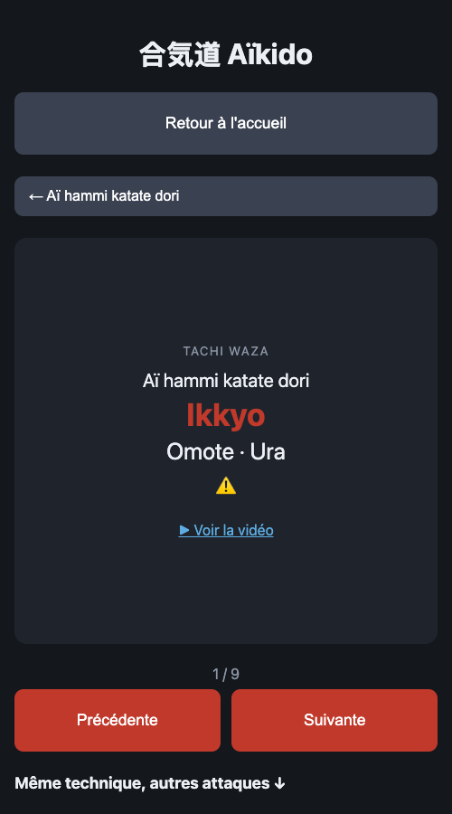

# 合気道 Aïkido Trainer

Petite application web pour **s'entraîner et réviser les techniques d'aïkido** (passage de grades Kyo) : elle tire au hasard une technique, te laisse réfléchir, puis te donne la suivante. Elle fonctionne sur mobile comme sur ordinateur, s'installe sur l'écran d'accueil et marche **hors ligne**.

👉 **https://devsigner.github.io/aikido-trainer**

<p>
  
  
  
</p>

## Manuel d'utilisation

### 1. Accueil

- **Grade** : choisis le grade à réviser (1er, 2ème ou 3ème Kyo). Le nombre de techniques est indiqué. Les grades se cumulent : le 2ème Kyo inclut le 3ème, et le 1er Kyo inclut le 2ème et le 3ème.
- **Filtres** :
  - 🆕 *Nouveautés* : uniquement les techniques nouvelles du programme ;
  - ⚠️ *Attention* : uniquement les techniques à travailler en priorité ;
  - les deux cochés : l'un **ou** l'autre ; aucun coché : tout le programme.
- **Waza** : touche *Tachi waza*, *Hanmi Handachi waza* ou *Suwari waza* pour lancer une session. Un waza grisé n'a aucune technique avec les filtres choisis.

### 2. Tirage

Chaque tirage affiche une carte complète :

| Élément                | Exemple              |
|------------------------|----------------------|
| Waza                   | TACHI WAZA           |
| Attaque                | Aï hammi katate dori |
| Technique              | **Nikkyo**           |
| Forme (si elle existe) | Ura                  |
| Marqueurs              | 🆕 ⚠️                |
| Note (si elle existe)  | « Naname »           |
| Vidéo (si elle existe) | ▶ Voir la vidéo      |

Le lien « ▶ Voir la vidéo » demande d'abord une confirmation (la technique filmée peut différer de celle attendue au passage de grade) ; une case permet de ne plus afficher ce message.

Le compteur « 3 / 115 » indique ta progression dans le waza.

- **Technique suivante** : tire la suivante.
- **Voir le programme** : ouvre le programme complet sans interrompre la session.
- **Retour à l'accueil** : termine la session (tu peux aussi toucher le titre « 合気道 Aïkido »).

**Règles du tirage**

- Tirage **uniforme** sur toutes les combinaisons *attaque × technique × forme*.
- Les techniques 🆕 *Nouveau* et ⚠️ *Attention* sortent **un peu plus souvent** (×1,5 chacune, cumulables).
- **Aucune répétition** pendant une session : quand tout est passé, l'app affiche « Waza terminé 🎉 ».

### 3. Programme

Le programme permet de naviguer dans tout le contenu du waza, sur trois niveaux :

<p>
  
  
  
</p>

1. **Attaques** : liste triée du waza.
2. **Techniques** : celles de l'attaque choisie, avec leurs marqueurs 🆕 ⚠️.
3. **Fiche technique** : la carte complète, et en bas **Précédente / Suivante** pour passer d'une technique à l'autre de la même attaque (la liste boucle). En défilant, la liste « Même technique, autres attaques » permet de comparer la même technique sur d'autres attaques.

Les boutons « ← … » en haut remontent d'un niveau. Les filtres 🆕/⚠️ ne s'appliquent pas au programme.

### 4. Navigation

- **Boutons précédent / suivant du navigateur** : ils fonctionnent, et la carte glisse dans le sens correspondant.
- **Chaque écran a sa propre URL** (`#/2eme-kyo/Tachi%20waza/program/Katate%20dori/Sankyo`) : tu peux recharger la page ou partager un lien, l'app revient au même endroit. Un waza dans l'URL relance un tirage.

### 5. Installer l'application et l'utiliser hors ligne

- **iPhone / iPad** (Safari) : Partager → *Sur l'écran d'accueil*.
- **Android** (Chrome) : menu → *Installer l'application*.

Une fois ouverte une première fois avec du réseau, tout le contenu est mis en cache : l'app fonctionne ensuite sans connexion.

## Pour les développeurs

Application statique écrite en **[Gren](https://gren-lang.org)** (un langage fonctionnel typé dans la lignée d'Elm, compilateur 0.6.6) : modèle, messages, `update` pure, vue pure, commandes. Elle est compilée en un seul `app.js`, **commité** (GitHub Pages sert des fichiers statiques). Les données sont de simples fichiers JSON, un par grade, dans `data/`.

```
yarn install                  # une fois (compilateur Gren, serveur local)
yarn build                    # compile src/*.gren → app.js
yarn server                   # http://localhost:8000
yarn test                     # compilation, tests Gren, app.js à jour, données, PWA
```

Un hook Git `pre-commit` (dossier `.githooks/`, activé automatiquement par `yarn install`) lance les tests avant chaque commit, et bloque le commit en cas d'échec. Pour le contourner exceptionnellement : `git commit --no-verify`.

Pour le time-travel debugger de Gren, compile en mode debug : `node_modules/.bin/gren make Main --debug --output=app.js` (ne pas commiter ce build).

### L'architecture Elm

Tout l'état vit dans un seul `Model`, ne change que par des `Msg`, et l'affichage est une fonction pure de cet état. Les effets (réseau, hasard, URL, `localStorage`) sont des `Cmd` : `update` reste pure.

| Module | Rôle |
|---|---|
| `src/Main.gren` | `Browser.application` : `init`, `update`, URL |
| `src/Types.gren` | `Model`, `Msg`, `Screen` (Home, Quiz, Program), `routeOf` |
| `src/Shared/Grade.gren` | données des grades : décodeurs JSON, fusion (héritage), pool pondéré, tirage, tri |
| `src/Shared/Route.gren` | lecture et écriture de l'URL `#/grade/waza/program/attack/technique` |
| `src/Navigation/` | URL ↔ écran : clé du navigateur, route de démarrage, `push` / `replace`, retour / avance |
| `src/Quiz/`, `src/Program/` | tirage sans répétition (modèle, `update`, vues) et navigation attaque → technique → carte |
| `src/Catalog/` | grades (chargement HTTP des JSON, grade choisi, filtres) et leur sélecteur |
| `src/Slide/`, `src/Video/`, `src/Layout/` | découpage par feature : direction des slides, vidéo (modèle, `update`, modale), page et carte partagées |
| `src/View.gren` | toute la vue (mêmes ids et classes CSS que `style.css`) |

- **Hasard** : `Random.generate Rolled` ; `Rolled` retire l'entrée tirée du pool (pas de répétition).
- **URL** : chaque écran a sa route. Une action de l'utilisateur fait un `pushUrl`, et `UrlChanged` (retour/avance du navigateur, rechargement) réapplique la route, corrigée si besoin (grade, waza, attaque ou technique inconnus). La direction du glissement se déduit de la profondeur de la route.
- **Données** : chargées au démarrage (`data/grades.json`, puis chaque fichier une fois) et fusionnées par grade ; le service worker les met en cache pour le hors-ligne.
- **Vidéo** : la modale de confirmation contient un lien `target=_blank` ; la préférence « ne plus demander » est écrite dans `localStorage` (lue au démarrage par `index.html`, passée en flag).

#### Tests

- `tests/gren/Main.gren` : tests unitaires Gren (`Grade`, `Route`), lancés par `tests/gren.test.js` avec le vérificateur « `app.js` est à jour ».
- `tests/data.test.js` : validité des JSON, héritage, ordres, version, PWA.

#### Ajouter une fonctionnalité

1. Ajouter les champs au `Model` et le `Msg` dans `src/Types.gren`.
2. Traiter le `Msg` dans `update` (`src/Main.gren`) ; un effet est une `Cmd` qui renvoie un `Msg`.
3. Afficher le résultat dans `src/View.gren` et, si besoin, le style dans `style.css`.
4. Écrire le test, `yarn build`, puis incrémenter la version (voir `CLAUDE.md`).

Le détail du format des données JSON, de l'héritage entre grades, de l'ordre d'affichage et de la procédure de version est dans [`CLAUDE.md`](CLAUDE.md).
