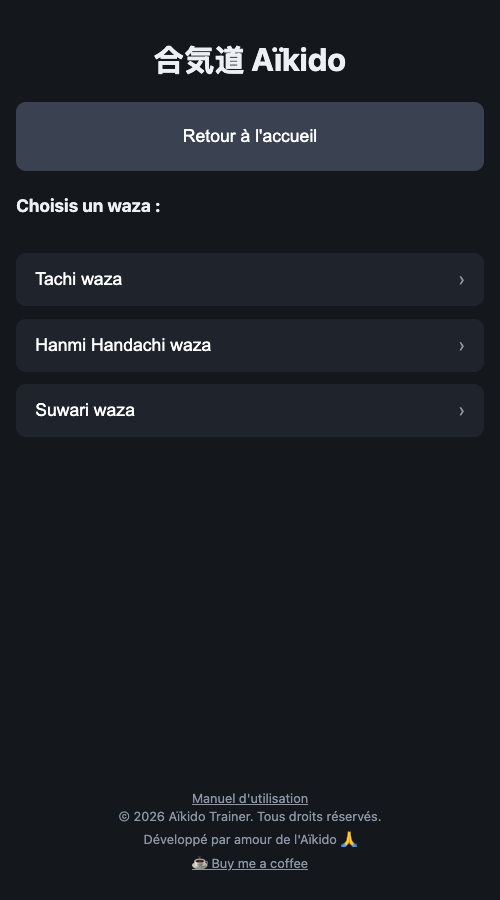
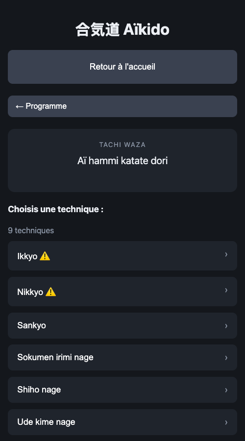
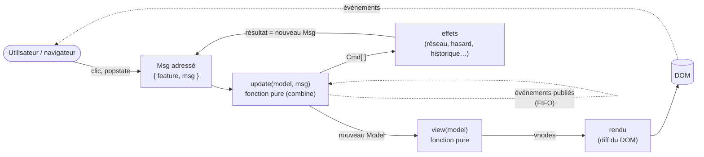
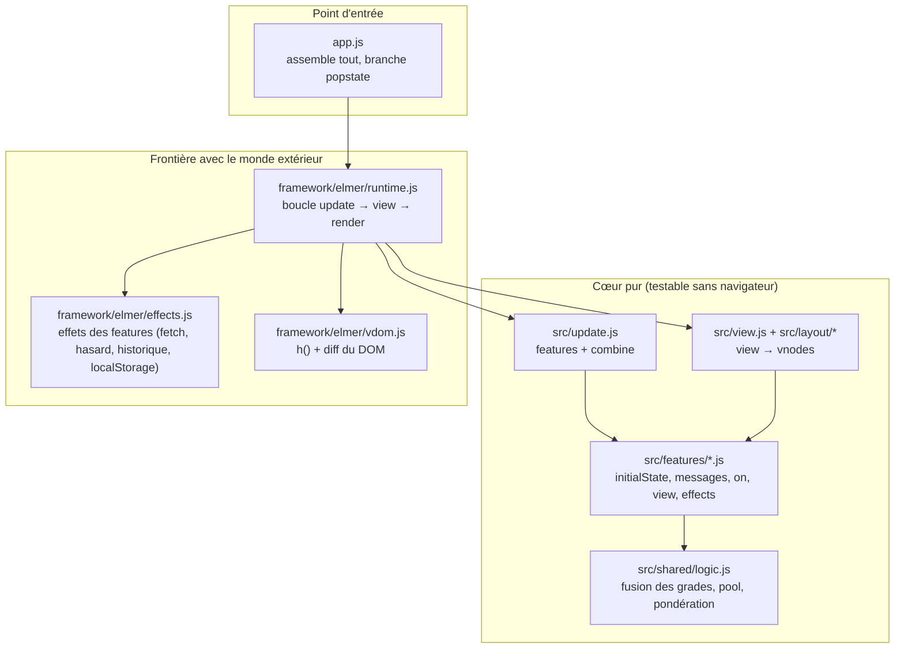
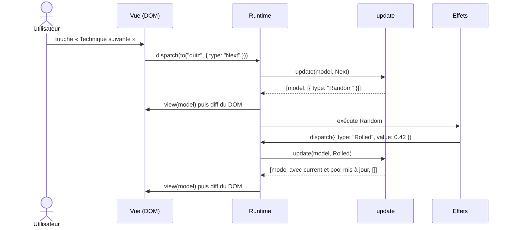
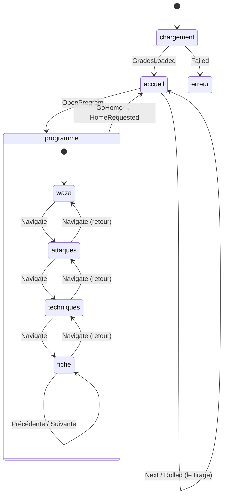
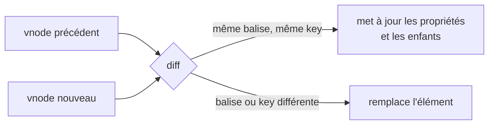
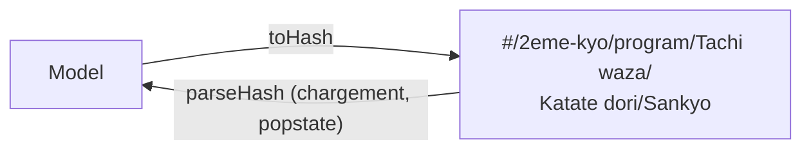

# 合気道 Aïkido Trainer

Petite application web pour **s'entraîner et réviser les techniques d'aïkido** (passage de grades Kyo) : elle tire au hasard une technique, te laisse réfléchir, puis te donne la suivante. Elle fonctionne sur mobile comme sur ordinateur, s'installe sur l'écran d'accueil et marche **hors ligne**.

👉 **https://devsigner.github.io/aikido-trainer**

<p>
  
  
  
</p>

## Manuel d'utilisation

### 1. Accueil

Le tirage démarre dès l'ouverture : une technique est déjà affichée, tous waza confondus.

- **Grade** : choisis le grade à réviser (1er, 2ème ou 3ème Kyo). Le nombre de techniques est indiqué. Les grades se cumulent : le 2ème Kyo inclut le 3ème, et le 1er Kyo inclut le 2ème et le 3ème. Changer de grade relance une session.
- **Programme** : bouton juste sous le grade, ouvre le programme (voir plus bas).
- **Filtres** (changer un filtre relance une session) :
  - 🆕 *Nouveautés* : uniquement les techniques nouvelles du programme ;
  - ⚠️ *Attention* : uniquement les techniques à travailler en priorité ;
  - les deux cochés : l'un **ou** l'autre ; aucun coché : tout le programme ;
  - **Waza** (liste) : « Tous les waza » (par défaut), *Tachi waza*, *Hanmi Handachi waza* ou *Suwari waza*. Le waza et les marqueurs se cumulent (Suwari waza + ⚠️ = les techniques « Attention » de Suwari waza).

### 2. Tirage

Chaque tirage affiche une carte complète :

| Élément                | Exemple              |
|------------------------|----------------------|
| Waza                   | TACHI WAZA           |
| Attaque                | Aï hammi katate dori |
| Technique              | **Nikkyo**           |
| Forme (si elle existe) | Ura                  |
| Marqueurs              | 🆕 ⚠️                |
| Note (si elle existe)  | « Naname »           |
| Vidéo (si elle existe) | ▶ Voir la vidéo      |

Le lien « ▶ Voir la vidéo » demande d'abord une confirmation (la technique filmée peut différer de celle attendue au passage de grade) ; une case permet de ne plus afficher ce message.

Le compteur « 3 / 115 » indique ta progression dans la session.

- **Technique suivante** : tire la suivante.

**Règles du tirage**

- Tirage **uniforme** sur toutes les combinaisons *attaque × technique × forme*.
- Les techniques 🆕 *Nouveau* et ⚠️ *Attention* sortent **un peu plus souvent** (×1,5 chacune, cumulables).
- **Aucune répétition** pendant une session : quand tout est passé, l'app affiche « Session terminée 🎉 ». Ouvrir le programme ne change pas la session : à ton retour, tu reprends où tu t'étais arrêté. Le bouton **i** en haut à droite de la carte ouvre directement la fiche de la technique dans le programme.

### 3. Programme

Le programme permet de naviguer dans tout le contenu d'un waza, sur quatre niveaux :

<p>
  
  
  
</p>

1. **Waza** : *Tachi waza*, *Hanmi Handachi waza* ou *Suwari waza* (un waza sans attaque est grisé).
2. **Attaques** : liste triée du waza.
3. **Techniques** : celles de l'attaque choisie, avec leurs marqueurs 🆕 ⚠️.
4. **Fiche technique** : la carte complète, et en bas **Précédente / Suivante** pour passer d'une technique à l'autre de la même attaque (la liste boucle). En défilant, la liste « Même technique, autres attaques » permet de comparer la même technique sur d'autres attaques.

Les boutons « ← … » en haut remontent d'un niveau, et « Retour à l'accueil » revient au tirage (tu peux aussi toucher le titre « 合気道 Aïkido »). Les filtres 🆕/⚠️ ne s'appliquent pas au programme.

### 4. Navigation

- **Boutons précédent / suivant du navigateur** : ils fonctionnent, et la carte glisse dans le sens correspondant.
- **Chaque écran a sa propre URL** (`#/2eme-kyo/program/Tachi%20waza/Katate%20dori/Sankyo`) : tu peux recharger la page ou partager un lien, l'app revient au même endroit. Le tirage, lui, n'est pas dans l'URL : il redémarre.

### 5. Installer l'application et l'utiliser hors ligne

- **iPhone / iPad** (Safari) : Partager → *Sur l'écran d'accueil*.
- **Android** (Chrome) : menu → *Installer l'application*.

Une fois ouverte une première fois avec du réseau, tout le contenu est mis en cache : l'app fonctionne ensuite sans connexion.

## Pour les développeurs

Application 100 % statique, **sans dépendance ni build** : HTML, CSS et JavaScript natif (modules ES), organisée selon le pattern Elm (modèle, messages, `update` pure, vue pure, effets). Les données sont de simples fichiers JSON, un par grade, dans `data/`.

```
python3 -m http.server 8000   # puis http://localhost:8000
yarn test                     # tests (runner natif de Node ≥ 20)
yarn lint                     # ESLint
```

Un hook Git `pre-commit` (dossier `.githooks/`, activé automatiquement par `yarn install`) lance le lint puis les tests avant chaque commit, et bloque le commit en cas d'échec. Pour le contourner exceptionnellement :

```
git commit --no-verify
```

### L'architecture Elm

[Elm](https://elm-lang.org) impose un flux de données **unidirectionnel** : tout l'état vit dans un seul objet, il ne change que par des **messages**, et l'affichage est une **fonction pure** de cet état. Ici le pattern est réimplémenté en JavaScript natif, dans le petit framework **ELMer** (`framework/elmer/`), en ~700 lignes.

#### La boucle



- **Model** : toutes les données de l'application (écran, grade, filtres, tirage en cours, programme…). Jamais modifié sur place : `update` en renvoie une copie.
- **Msg** : un objet `{ type, … }` qui décrit *ce qui s'est passé* (`Next`, `Rolled`, `Navigate`…). À la racine il est adressé à une feature : `{ feature, msg }` (`to("quiz", msg)`).
- **Feature** : un module `src/features/*.js` qui exporte `feature = defineFeature({ name, initialState, messages, on, view, effects… })` et possède sa tranche du modèle (`model.quiz`…). `combine` assemble les features en un `update` racine ; une feature n'écrit jamais la tranche d'une autre : elle **publie des événements** (`ProgramOpened`, `Navigated`, `ViewChanged`…) auxquels les autres s'abonnent dans `on`. Voir [`framework/elmer/README.md`](framework/elmer/README.md).
- **`update(model, msg) → [model, cmds, events?]`** (par feature, via `messages`) : fonction **pure**. Elle ne touche ni au DOM, ni au réseau, ni à `Math.random`. Elle *décrit* les effets souhaités sous forme de données (les `cmds`).
- **Cmd** : un effet décrit comme une donnée (`{ type: "Random" }`). Il est exécuté par la table d'effets des features (`framework/elmer/effects.js`), qui renvoie son résultat sous la forme d'un nouveau message.
- **`view(model) → vnode`** : fonction **pure** qui produit un arbre de données. Les gestionnaires d'événements sont eux aussi des messages, pas des fonctions qui modifient l'état.

#### Qui fait quoi



Les modules du cœur pur n'ont aucun effet de bord : ils sont testés directement avec `node:test`. Les tests d'intégration (`tests/helpers.js`) font tourner la **vraie** boucle avec le vrai JSON et un historique simulé.

#### Un aller-retour complet : « Technique suivante »

Le hasard est lui-même un effet : `update` ne tire jamais au sort, ce qui rend les tirages **reproductibles dans les tests** (on injecte un `random` fixe).



#### Les écrans et leurs transitions



Les quatre niveaux du programme sont stockés dans `model.program = { current: { level, waza?, attack?, technique? } }` (la tranche n'existe que programme ouvert). La tranche `quiz` existe en permanence : la session démarre au chargement des données et redémarre quand le grade ou un filtre change (événements `GradesLoaded`, `GradeLoaded`, ou ses propres filtres) ; ouvrir le programme n'y touche pas.

#### Principaux messages et effets

| Feature | Message | Déclenché par | Effet produit (`cmds`) / événement publié |
|---------|---------|---------------|-------------------------------------------|
| `catalog` | `GradesLoaded` / `GradeLoaded` | fin du chargement des JSON | événements `GradesLoaded` / `GradeLoaded` |
| `catalog` | `SelectGrade` | liste des grades | `LoadGrade`, `Navigated` |
| `quiz` | `SetFilter`, `SelectWaza` | cases 🆕 / ⚠️, liste des waza | `Random` (nouvelle session) |
| `quiz` | `Next` | « Technique suivante » | `Random` |
| `quiz` | (événements `GradesLoaded`, `GradeLoaded`) | données changées | `Random` (nouvelle session) |
| `quiz` | `Rolled` | retour de l'effet `Random` | `ViewChanged` |
| `program` | `OpenProgram`, `Navigate`, `CloseProgram` | bouton « Programme », boutons du programme | `Navigated`, `ViewChanged` |
| `navigation` | `GoHome` | « Retour à l'accueil » du programme, titre | `HomeRequested` |
| `navigation` | `Popped` | précédent/suivant du navigateur | `RouteChanged` (l'URL fait foi) |
| `navigation` | (événement `Navigated`) | une feature change ce que l'URL montre | `Url` (écrit l'URL) |
| `video` | `AskVideo`, `SetDontAsk`, `CancelVideo` | modale de confirmation | — |
| `video` | `ConfirmVideo` | « Voir la vidéo » dans la modale | `OpenUrl`, `SaveSkipVideoWarning` |

#### Le rendu : un mini DOM virtuel

`view` produit des `vnode` (écrits avec `` html`<div>…</div>` ``, équivalent JSX sans build) (objets simples) avec `h(tag, props, ...enfants)`. `framework/elmer/vdom.js` compare l'arbre précédent au nouveau et ne modifie dans le DOM réel que ce qui a changé :



Une `key` différente force le remplacement de l'élément : c'est ce qui relance l'animation de glissement de la carte à chaque changement de technique.

#### L'URL, source de vérité de la navigation



Chaque changement d'écran ajoute une entrée d'historique (commande `Url`). La feature `navigation` retient la position dans l'historique (`model.navigation.position`), ce qui permet de savoir si un `popstate` est un retour ou une avance ; la direction est transmise dans `RouteChanged`. Les features `quiz` et `program` publient `ViewChanged` quand la carte change, et la feature `slide` en tire l'animation.

#### Mode debug

En local (`localhost`), le debugger est monté automatiquement ; ailleurs, tape `__elmer.debug.on()` dans la console du navigateur (`__elmer.debug.off()` pour le démonter et ne plus le monter automatiquement, même en local ; `__elmer.help` liste l'API). Un bouton 🐞 ouvre un panneau flottant, à la manière du debugger d'Elm. Il s'ouvre à gauche de l'écran ; on le **déplace** en glissant sa barre rouge et on le **redimensionne** avec le coin en bas à droite (souris ou doigt).

- **État** : le modèle courant en JSON (les données des grades et le pool de tirage sont résumés).
- **Messages** : le journal de tous les messages (200 derniers). Un clic affiche le message, les **commandes** qu'il a produites et les **champs du modèle modifiés**.
- **Voyage dans le temps** : « Revenir à l'état après ce message » remet le modèle d'alors (les effets ne sont pas rejoués ; l'URL n'est pas modifiée).
- **Copier** l'état ou le journal pour un rapport de bug. Dans la console : `__elmer.model`, `__elmer.debug.log`, `__elmer.debug.restore(id)` (renvoie le modèle restauré, `null` si l'id est inconnu).

Le dossier `framework/elmer/debug/` n'est chargé que lorsqu'il est monté ; `run` garde seulement les 200 derniers messages en mémoire et les rejoue dans le panneau au montage. L'app le configure par `devtools: { hide }` (voir `framework/elmer/README.md`).

#### Ajouter une fonctionnalité

1. Choisir la feature concernée (`src/features/*.js`) ou en créer une avec `defineFeature` (puis l'ajouter à la liste `features` de `src/update.js`, à l'import map de `index.html` et au précache de `sw.js`).
2. Ajouter les champs nécessaires à son **`model`**, et le **Msg** dans `messages` : renvoyer le nouveau modèle et, si besoin, des `cmds` ou des événements à publier.
3. Si un effet est nécessaire, l'ajouter dans `effects` de la feature (il renvoie son résultat par un nouveau message).
4. Afficher le résultat dans sa `view` / `views` (ou `src/layout/*`) et, si besoin, le style dans `style.css`.
5. Écrire le test, puis lancer `yarn bump` pour mettre à jour la version (voir `CLAUDE.md`).

Le détail du format des données JSON, de l'héritage entre grades, de l'ordre d'affichage et de la procédure de version est dans [`CLAUDE.md`](CLAUDE.md).
