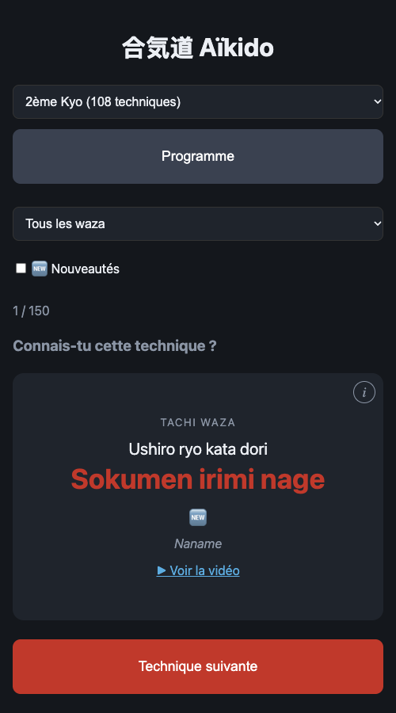
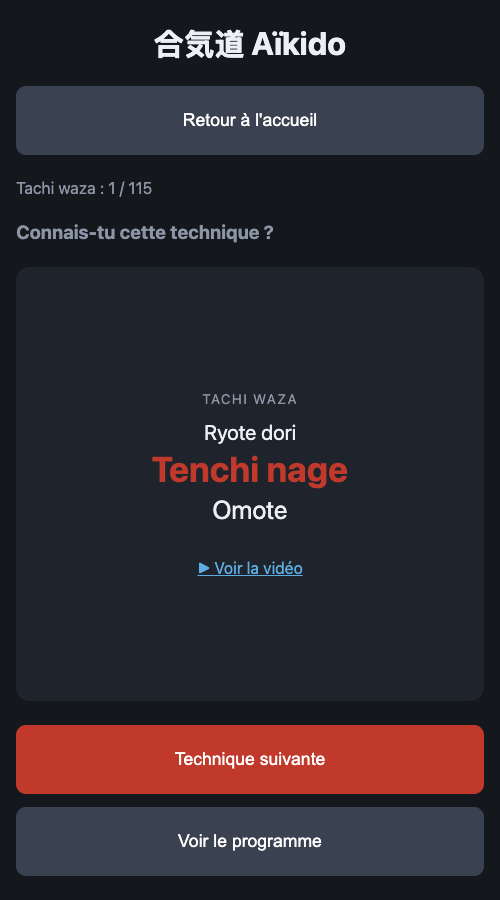
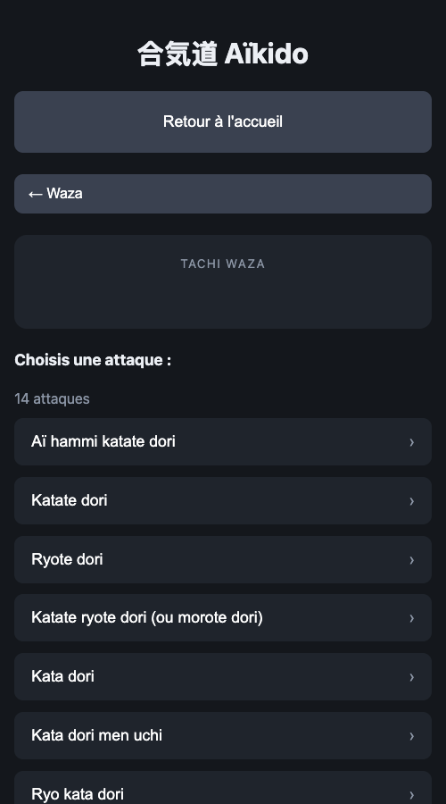
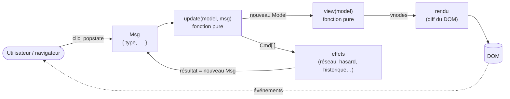
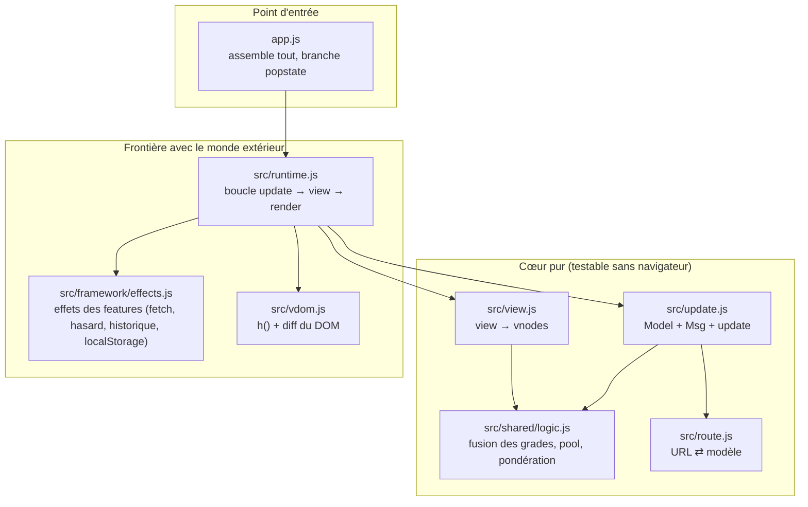
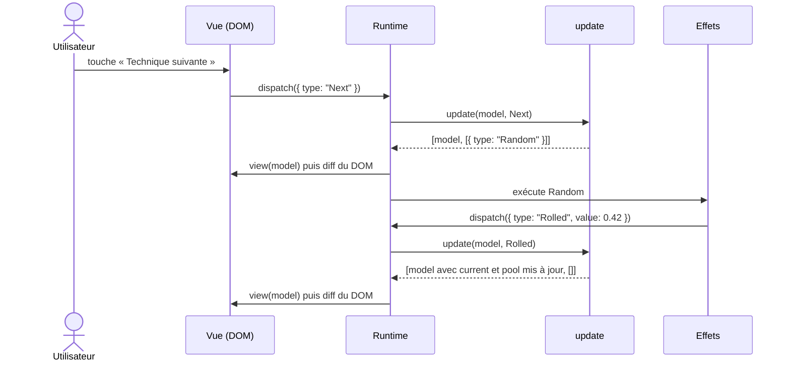
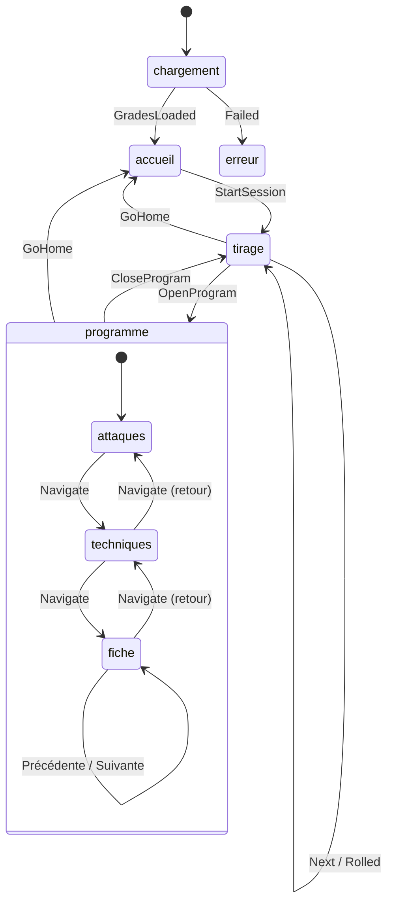
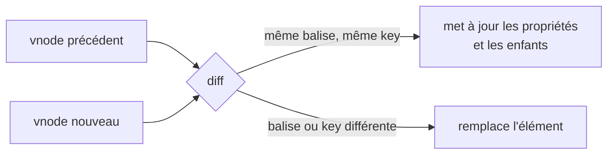
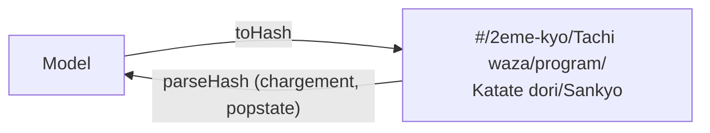

# 合気道 Aïkido Trainer

Petite application web pour **s'entraîner et réviser les techniques d'aïkido** (passage de grades Kyo) : elle tire au hasard une technique, te laisse réfléchir, puis te donne la suivante. Elle fonctionne sur mobile comme sur ordinateur, s'installe sur l'écran d'accueil et marche **hors ligne**.

👉 **https://devsigner.github.io/aikido-trainer**

<p>
  
  
  
</p>

## Manuel d'utilisation

### 1. Accueil

- **Grade** : choisis le grade à réviser (1er, 2ème ou 3ème Kyo). Le nombre de techniques est indiqué. Les grades se cumulent : le 2ème Kyo inclut le 3ème, et le 1er Kyo inclut le 2ème et le 3ème.
- **Filtres** :
  - 🆕 *Nouveautés* : uniquement les techniques nouvelles du programme ;
  - ⚠️ *Attention* : uniquement les techniques à travailler en priorité ;
  - les deux cochés : l'un **ou** l'autre ; aucun coché : tout le programme.
- **Waza** : touche *Tachi waza*, *Hanmi Handachi waza* ou *Suwari waza* pour lancer une session. Un waza grisé n'a aucune technique avec les filtres choisis.

### 2. Tirage

Chaque tirage affiche une carte complète :

| Élément                | Exemple              |
|------------------------|----------------------|
| Waza                   | TACHI WAZA           |
| Attaque                | Aï hammi katate dori |
| Technique              | **Nikkyo**           |
| Forme (si elle existe) | Ura                  |
| Marqueurs              | 🆕 ⚠️                |
| Note (si elle existe)  | « Naname »           |
| Vidéo (si elle existe) | ▶ Voir la vidéo      |

Le lien « ▶ Voir la vidéo » demande d'abord une confirmation (la technique filmée peut différer de celle attendue au passage de grade) ; une case permet de ne plus afficher ce message.

Le compteur « 3 / 115 » indique ta progression dans le waza.

- **Technique suivante** : tire la suivante.
- **Voir le programme** : ouvre le programme complet sans interrompre la session.
- **Retour à l'accueil** : termine la session (tu peux aussi toucher le titre « 合気道 Aïkido »).

**Règles du tirage**

- Tirage **uniforme** sur toutes les combinaisons *attaque × technique × forme*.
- Les techniques 🆕 *Nouveau* et ⚠️ *Attention* sortent **un peu plus souvent** (×1,5 chacune, cumulables).
- **Aucune répétition** pendant une session : quand tout est passé, l'app affiche « Waza terminé 🎉 ».

### 3. Programme

Le programme permet de naviguer dans tout le contenu du waza, sur trois niveaux :

<p>
  
  
  
</p>

1. **Attaques** : liste triée du waza.
2. **Techniques** : celles de l'attaque choisie, avec leurs marqueurs 🆕 ⚠️.
3. **Fiche technique** : la carte complète, et en bas **Précédente / Suivante** pour passer d'une technique à l'autre de la même attaque (la liste boucle). En défilant, la liste « Même technique, autres attaques » permet de comparer la même technique sur d'autres attaques.

Les boutons « ← … » en haut remontent d'un niveau. Les filtres 🆕/⚠️ ne s'appliquent pas au programme.

### 4. Navigation

- **Boutons précédent / suivant du navigateur** : ils fonctionnent, et la carte glisse dans le sens correspondant.
- **Chaque écran a sa propre URL** (`#/2eme-kyo/Tachi%20waza/program/Katate%20dori/Sankyo`) : tu peux recharger la page ou partager un lien, l'app revient au même endroit. Un waza dans l'URL relance un tirage.

### 5. Installer l'application et l'utiliser hors ligne

- **iPhone / iPad** (Safari) : Partager → *Sur l'écran d'accueil*.
- **Android** (Chrome) : menu → *Installer l'application*.

Une fois ouverte une première fois avec du réseau, tout le contenu est mis en cache : l'app fonctionne ensuite sans connexion.

## Pour les développeurs

Application 100 % statique, **sans dépendance ni build** : HTML, CSS et JavaScript natif (modules ES), organisée selon le pattern Elm (modèle, messages, `update` pure, vue pure, effets). Les données sont de simples fichiers JSON, un par grade, dans `data/`.

```
python3 -m http.server 8000   # puis http://localhost:8000
yarn test                     # tests (runner natif de Node ≥ 20)
yarn lint                     # ESLint
```

Un hook Git `pre-commit` (dossier `.githooks/`, activé automatiquement par `yarn install`) lance le lint puis les tests avant chaque commit, et bloque le commit en cas d'échec. Pour le contourner exceptionnellement :

```
git commit --no-verify
```

### L'architecture Elm

[Elm](https://elm-lang.org) impose un flux de données **unidirectionnel** : tout l'état vit dans un seul objet, il ne change que par des **messages**, et l'affichage est une **fonction pure** de cet état. Ici le pattern est réimplémenté en JavaScript natif, en ~700 lignes.

#### La boucle



- **Model** : toutes les données de l'application (écran, grade, filtres, tirage en cours, programme…). Jamais modifié sur place : `update` en renvoie une copie.
- **Msg** : un objet `{ type, … }` qui décrit *ce qui s'est passé* (`StartSession`, `Next`, `Rolled`, `Navigate`…).
- **`update(model, msg) → [model, cmds]`** : fonction **pure**. Elle ne touche ni au DOM, ni au réseau, ni à `Math.random`. Elle *décrit* les effets souhaités sous forme de données (les `cmds`).
- **Cmd** : un effet décrit comme une donnée (`{ type: "Random" }`). Il est exécuté par la table d'effets des features (`src/framework/effects.js`), qui renvoie son résultat sous la forme d'un nouveau message.
- **`view(model) → vnode`** : fonction **pure** qui produit un arbre de données. Les gestionnaires d'événements sont eux aussi des messages, pas des fonctions qui modifient l'état.

#### Qui fait quoi



Les modules du cœur pur n'ont aucun effet de bord : ils sont testés directement avec `node:test`. Les tests d'intégration (`tests/helpers.js`) font tourner la **vraie** boucle avec le vrai JSON et un historique simulé.

#### Un aller-retour complet : « Technique suivante »

Le hasard est lui-même un effet : `update` ne tire jamais au sort, ce qui rend les tirages **reproductibles dans les tests** (on injecte un `random` fixe).



#### Les écrans et leurs transitions



Les trois niveaux du programme sont stockés dans `model.program.at = { level, attack?, technique? }` (`null` quand le programme est fermé).

#### Principaux messages et effets

| Message | Déclenché par | Effet produit (`cmds`) |
|---------|---------------|------------------------|
| `GradesLoaded` / `GradeLoaded` | fin du chargement des JSON | `Url` (remplace l'URL) |
| `SelectGrade` | liste des grades | `LoadGrade`, `Url` |
| `SetFilter` | cases 🆕 / ⚠️ | — |
| `StartSession` | bouton d'un waza | `Url`, `Random` |
| `Next` | « Technique suivante » | `Random` |
| `Rolled` | retour de l'effet `Random` | — |
| `OpenProgram`, `Navigate`, `CloseProgram` | boutons du programme | `Url` |
| `GoHome` | « Retour à l'accueil », titre | `Url` |
| `Popped` | précédent/suivant du navigateur | — (l'URL fait foi) |
| `AskVideo`, `SetDontAsk`, `CancelVideo` | modale de confirmation | — |
| `ConfirmVideo` | « Voir la vidéo » dans la modale | `OpenUrl`, `SaveSkipVideoWarning` |

#### Le rendu : un mini DOM virtuel

`view` produit des `vnode` (objets simples) avec `h(tag, props, ...enfants)`. `src/framework/vdom.js` compare l'arbre précédent au nouveau et ne modifie dans le DOM réel que ce qui a changé :



Une `key` différente force le remplacement de l'élément : c'est ce qui relance l'animation de glissement de la carte à chaque changement de technique.

#### L'URL, source de vérité de la navigation



Chaque changement d'écran ajoute une entrée d'historique (commande `Url`). Le modèle retient sa position dans l'historique, ce qui permet de savoir si un `popstate` est un retour ou une avance et d'orienter l'animation en conséquence.

#### Mode debug

Ajoute `?debug` à l'URL (ex. `http://localhost:8000/?debug`) : un bouton 🐞 ouvre un panneau flottant, à la manière du debugger d'Elm. Il s'ouvre à gauche de l'écran ; on le **déplace** en glissant sa barre rouge et on le **redimensionne** avec le coin en bas à droite (souris ou doigt).

- **État** : le modèle courant en JSON (les données des grades et le pool de tirage sont résumés).
- **Messages** : le journal de tous les messages (200 derniers). Un clic affiche le message, les **commandes** qu'il a produites et les **champs du modèle modifiés**.
- **Voyage dans le temps** : « Revenir à l'état après ce message » remet le modèle d'alors (les effets ne sont pas rejoués ; l'URL n'est pas modifiée).
- **Copier** l'état ou le journal pour un rapport de bug. Dans la console : `__debug.model`, `__debug.log`, `__debug.restore(id)`.

Le mode est mémorisé dans le navigateur ; `?debug=0` le désactive. Le module `src/framework/debug.js` n'est chargé que s'il est actif : aucun coût en usage normal. Il s'appuie sur un simple observateur (`debug`) de `run`, qui reçoit chaque `{ msg, before, after, cmds }`.

#### Ajouter une fonctionnalité

1. Ajouter les champs nécessaires au **Model** (`initialModel` dans `src/update.js`).
2. Définir le **Msg** et son cas dans `step` (`update`) : renvoyer le nouveau modèle et, si besoin, des `cmds`.
3. Si un effet est nécessaire, l'ajouter dans la feature concernée (`effects` de `src/features/*.js`, il renvoie son résultat par un nouveau message).
4. Afficher le résultat dans `view` (`src/view.js`) et, si besoin, le style dans `style.css`.
5. Écrire le test, puis incrémenter la version (voir `CLAUDE.md`).

Le détail du format des données JSON, de l'héritage entre grades, de l'ordre d'affichage et de la procédure de version est dans [`CLAUDE.md`](CLAUDE.md).
