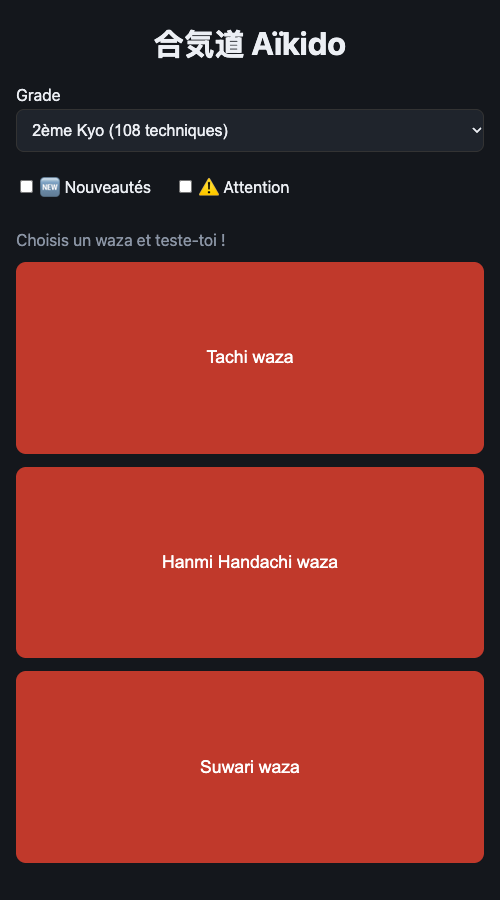
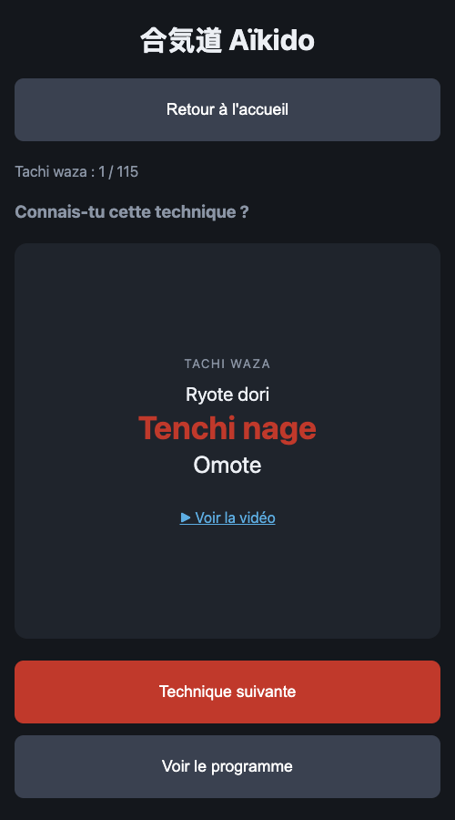
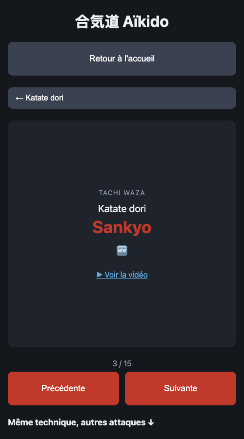
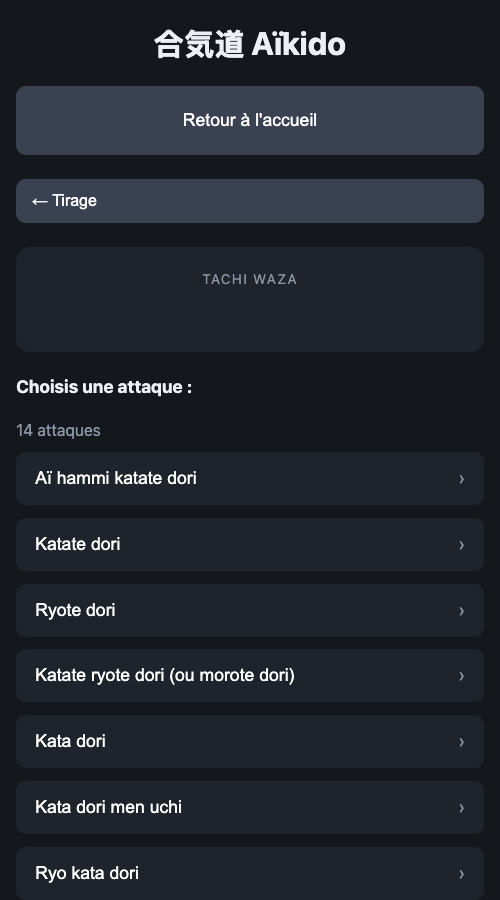
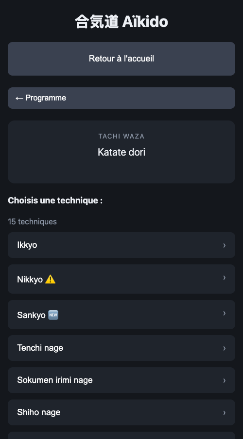

# 合気道 Aïkido Trainer

Petite application web pour **s'entraîner et réviser les techniques d'aïkido** (passage de grades Kyo) : elle tire au hasard une technique, te laisse réfléchir, puis te donne la suivante. Elle fonctionne sur mobile comme sur ordinateur, s'installe sur l'écran d'accueil et marche **hors ligne**.

👉 **https://devsigner.github.io/aikido-trainer**

<p>
  
  
  
</p>

## Manuel d'utilisation

### 1. Accueil

- **Grade** : choisis le grade à réviser (1er, 2ème ou 3ème Kyo). Le nombre de techniques est indiqué. Les grades se cumulent : le 2ème Kyo inclut le 3ème, et le 1er Kyo inclut le 2ème et le 3ème.
- **Filtres** :
  - 🆕 *Nouveautés* : uniquement les techniques nouvelles du programme ;
  - ⚠️ *Attention* : uniquement les techniques à travailler en priorité ;
  - les deux cochés : l'un **ou** l'autre ; aucun coché : tout le programme.
- **Waza** : touche *Tachi waza*, *Hanmi Handachi waza* ou *Suwari waza* pour lancer une session. Un waza grisé n'a aucune technique avec les filtres choisis.

### 2. Tirage

Chaque tirage affiche une carte complète :

| Élément                | Exemple              |
|------------------------|----------------------|
| Waza                   | TACHI WAZA           |
| Attaque                | Aï hammi katate dori |
| Technique              | **Nikkyo**           |
| Forme (si elle existe) | Ura                  |
| Marqueurs              | 🆕 ⚠️                |
| Note (si elle existe)  | « Naname »           |
| Vidéo (si elle existe) | ▶ Voir la vidéo      |

Le lien « ▶ Voir la vidéo » demande d'abord une confirmation (la technique filmée peut différer de celle attendue au passage de grade) ; une case permet de ne plus afficher ce message.

Le compteur « 3 / 115 » indique ta progression dans le waza.

- **Technique suivante** : tire la suivante.
- **Voir le programme** : ouvre le programme complet sans interrompre la session.
- **Retour à l'accueil** : termine la session (tu peux aussi toucher le titre « 合気道 Aïkido »).

**Règles du tirage**

- Tirage **uniforme** sur toutes les combinaisons *attaque × technique × forme*.
- Les techniques 🆕 *Nouveau* et ⚠️ *Attention* sortent **un peu plus souvent** (×1,5 chacune, cumulables).
- **Aucune répétition** pendant une session : quand tout est passé, l'app affiche « Waza terminé 🎉 ».

### 3. Programme

Le programme permet de naviguer dans tout le contenu du waza, sur trois niveaux :

<p>
  
  
  
</p>

1. **Attaques** : liste triée du waza.
2. **Techniques** : celles de l'attaque choisie, avec leurs marqueurs 🆕 ⚠️.
3. **Fiche technique** : la carte complète, et en bas **Précédente / Suivante** pour passer d'une technique à l'autre de la même attaque (la liste boucle). En défilant, la liste « Même technique, autres attaques » permet de comparer la même technique sur d'autres attaques.

Les boutons « ← … » en haut remontent d'un niveau. Les filtres 🆕/⚠️ ne s'appliquent pas au programme.

### 4. Navigation

- **Glisser vers la droite / la gauche** sur l'écran : revenir en arrière / avancer dans l'historique (comme les flèches du navigateur).
- **Boutons précédent / suivant du navigateur** : ils fonctionnent, et la carte glisse dans le sens correspondant.
- **Chaque écran a sa propre URL** (`#/2eme-kyo/Tachi%20waza/program/Katate%20dori/Sankyo`) : tu peux recharger la page ou partager un lien, l'app revient au même endroit. Un waza dans l'URL relance un tirage.

### 5. Installer l'application et l'utiliser hors ligne

- **iPhone / iPad** (Safari) : Partager → *Sur l'écran d'accueil*.
- **Android** (Chrome) : menu → *Installer l'application*.

Une fois ouverte une première fois avec du réseau, tout le contenu est mis en cache : l'app fonctionne ensuite sans connexion.

## Pour les développeurs

Application 100 % statique, **sans dépendance ni build** : HTML, CSS et JavaScript natif (modules ES), organisée selon le pattern Elm (modèle, messages, `update` pure, vue pure, effets). Les données sont de simples fichiers JSON, un par grade, dans `data/`.

```
python3 -m http.server 8000   # puis http://localhost:8000
yarn test                     # tests (runner natif de Node ≥ 20)
```

Le détail de l'architecture, du format des données JSON, de l'héritage entre grades, de l'ordre d'affichage et de la procédure de version est dans [`CLAUDE.md`](CLAUDE.md).
