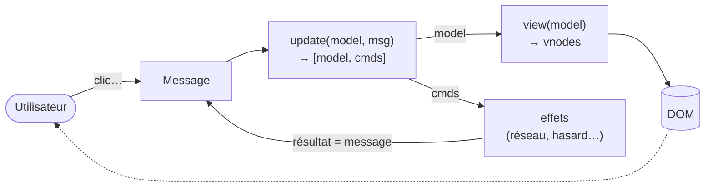
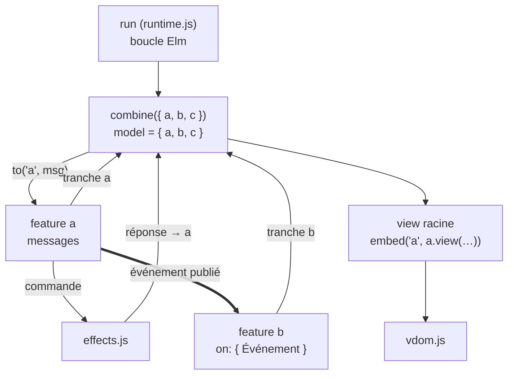
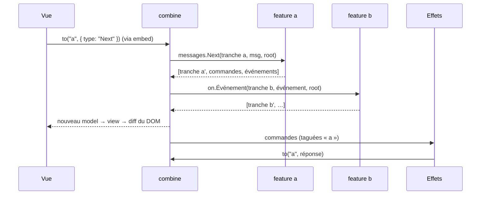
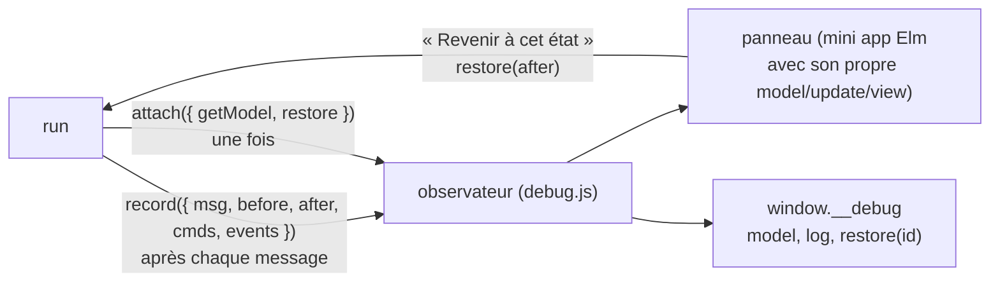

# ELMer : framework Elm par features

**ELMer** est un petit framework JS pur (ES modules, sans build ni dépendance).
Aucun fichier de ce dossier n'importe quoi que ce soit hors du dossier : on peut le copier tel quel dans un autre projet.

## Elm en bref

[Elm](https://elm-lang.org) : un **seul état** (le *model*), modifié uniquement par des **messages**, affiché par une **fonction pure**. Rien d'impur n'est fait directement : les effets (réseau, hasard, URL…) sont *décrits* par des données (les *commandes*), exécutés à l'extérieur, et leur résultat revient sous forme de message.



| Élément | Rôle |
|---------|------|
| **Model** | tout l'état de l'app, jamais modifié sur place |
| **Message** | `{ type, … }` : ce qui s'est passé |
| **update** | fonction **pure** `(model, msg) → [nouveau model, commandes]` |
| **Commande** | effet décrit en données (`{ type: "Random" }`) |
| **view** | fonction **pure** `model → arbre de vnodes` ; ses handlers sont des messages |

## ELMer = Elm + features

Pour qu'`update` ne devienne pas un énorme `switch`, ELMer découpe l'app en **features** : chacune a son bout de model (sa *tranche*), ses messages, sa vue et ses effets. `combine` les assemble en **un** programme Elm (`init`, `update`, `subscribe`, `effects`) que `run` exécute.



Le flux d'un clic :



En trois règles :
1. **Une feature n'écrit que sa tranche** ; elle lit les autres via `root` (lecture seule).
2. **Pour agir sur une autre feature, elle publie un événement** ; l'autre s'y abonne dans `on`.
3. **Tout est adressé** : messages `{ feature, msg }` (`to`, `embed`), commandes taguées par feature, donc la réponse d'un effet revient à sa feature.

## Les fichiers

| Fichier      | Rôle                                                                                                                      |
|--------------|---------------------------------------------------------------------------------------------------------------------------|
| `feature.js` | `defineFeature(spec)`, `combine({ nom: feature })`, `to(feature, msg)`, `embed(feature, vnode)`                                                          |
| `effects.js` | `createEffects` / `createSubscriptions(features, overrides)` : effets et abonnements des features, avec les services du navigateur par défaut (`fetchJson`, `random`, `history`, `storage`, `open`) |
| `vdom.js`    | `h()` et `createRenderer(root)` : mini DOM virtuel (les handlers sont des messages)                                       |
| `runtime.js` | `run({ init, update, view, render, effects, subscribe, flags, debug })` : boucle Elm                                      |
| `debug.js`   | `mountDebugger(slices, hide)` : panneau d'état, journal, voyage dans le temps (voir « Le debugger ») |

## Une feature

Une feature est un module qui exporte **`feature`**, déclaré avec `defineFeature` (les clés inconnues sont refusées ; `model` ou `init` est obligatoire) :

```js
export const feature = defineFeature({
  model,                                       // modèle initial (statique) de sa tranche
  lazy?,                                       // true : pas de tranche tant qu'aucun message ni événement abonné ne l'atteint
  init?(flags, model) → [model, cmds, events?],  // optionnel : flags, commandes de démarrage
  messages: { Type: (model, msg, root) → [model, cmds, events?] },   // root = modèle complet, en lecture seule
  on: { EventType: (model, event, root) → [model, cmds, events?] },
  view?, effects?(deps) → { CmdType: (cmd, dispatch) => … },
  subscribe?(dispatch, deps),                  // écoute le monde extérieur (popstate…) ; dispatch écrit à cette feature
  views?: { nom: (…) => vnode },               // morceaux de vue exposés aux autres
  events?: { nom: (…) => événement },          // constructeurs des événements publiés
});
```

Le nom de la feature est sa clé dans l'objet passé à `combine` : `combine({ counter, log })` → `model.counter`, `model.log`. Un message inconnu lève « Unknown message ».

- Une feature n'écrit que sa propre tranche. Pour agir sur une autre, elle **publie un événement** (3ᵉ élément du résultat) auquel l'autre s'abonne dans `on`.
- Les événements sont livrés dans l'ordre (FIFO) ; une boucle de plus de 1000 événements lève une erreur.
- Les messages racine sont des enveloppes `{ feature, msg }` ; les commandes sont taguées avec leur feature, et la réponse d'un effet retourne à celle-ci.
- `embed` enveloppe les handlers d'une vue de feature ; un message déjà adressé (`to(...)`) est laissé tel quel.
- **Feature `lazy`** : sa tranche n'existe pas à l'`init` ; elle est créée (avec `init(flags, model)`) au premier message ou événement auquel elle est abonnée. Un `update` ou une réaction qui renvoie `UNMOUNT` comme modèle supprime la tranche (les commandes et événements sont conservés) ; un nouveau message la recrée depuis `init`. Pendant ce temps `root[name]` est `undefined` : les autres features et la vue doivent le tolérer. Une réponse d'effet tardive la recrée aussi. Avec `lazy: { events: [types] }`, seuls un message ou ces événements créent la tranche ; les autres événements sont ignorés tant qu'elle est démontée.
- `combine({ nom: feature })` renvoie `{ init, update, subscribe, effects }`, directement utilisables par `run`.

## Le debugger

`mountDebugger(slices, hide)` (`debug.js`) renvoie un **observateur** à passer à `run({ debug })`. Le debugger n'est pas dans la boucle : il l'écoute, et n'est chargé que si on le demande (pour Aikido Trainer : `?debug`).



- **Journal** : chaque message est enregistré avec le modèle avant/après, les commandes émises et les événements publiés (200 derniers). Les messages de feature sont étiquetés `feature/Type`.
- **État** : le modèle courant, une section par tranche de feature. `hide` résume les champs volumineux (ex. les données d'un grade).
- **Diff** : les champs modifiés par un message, tranche par tranche (`video.prompt`).
- **Voyage dans le temps** : `restore(after)` remet un ancien modèle et redessine la vue. Les effets ne sont **pas** rejoués. Possible car le modèle est une simple donnée immuable et la vue une fonction pure de celui-ci.
- **Console** : `__debug.model`, `__debug.log`, `__debug.restore(id)`.

## Exemple

`examples/counter/` : deux features (compteur, journal qui réagit à un événement), avec le debugger (bouton 🐞). Servir la racine du dépôt (`python3 -m http.server`) et ouvrir `/examples/counter/`. Le test `tests/elmer.test.js` l'exerce.

## Extraire en dépôt séparé

Copier ce dossier (et `examples/`). Rien d'autre n'est requis ; pour l'import map et le service worker d'une app, enregistrer chaque fichier (voir `index.html` et `sw.js` d'Aikido Trainer).
